# csp-scalespace

[](https://github.com/drmitss/csp-scale-space/actions/workflows/tests.yml)
[](https://csp-scale-space.readthedocs.io/en/latest/)
[](LICENSE)

**Anisotropic spectral scale-space for multiscale nonlinear ODEs via Computational Singular Perturbation (CSP).**

📖 **Manual:** <https://csp-scale-space.readthedocs.io>

Reference implementation of

> D. M. Manias and L. Najman, *Anisotropic Spectral Scale-Space Formulation for Multiscale Nonlinear
> Ordinary Differential Equations via Computational Singular Perturbation*.

Classical CSP reduces a stiff system by choosing an integer number `M` of exhausted (fast) modes and
projecting them out - a binary switch. This package replaces the switch with a continuous dial: an
observation scale `σ`. Each CSP mode is attenuated by a smooth weight `w_i = exp[-(σ/τ_i)²]` that
depends on the ratio of `σ` to the mode's timescale `τ_i`, so one global model moves continuously
from the full dynamics (`σ → 0`) through every slow invariant manifold (SIM) of the system.

You give the package **a model** (equations, parameters, initial conditions) and it gives you

* the **figures of the paper computed for your model** - both the step-by-step theory figures
  (shown in the paper for the Davis-Skodje system) and the application figures (shown for the
  Michaelis-Menten mechanism and a three-scale network);
* a **report** with timescales, cutoff scales, CSP pointers and reduced-model errors;
* a small, documented **library** of the operators themselves (`S_σ`, pointers, Formulation A,
  Formulation B, the two-stage reduced model, first-order CSP refinements).

It also reproduces **every figure of the paper** exactly (`paper/`).

| | | |
|---|---|---|
| 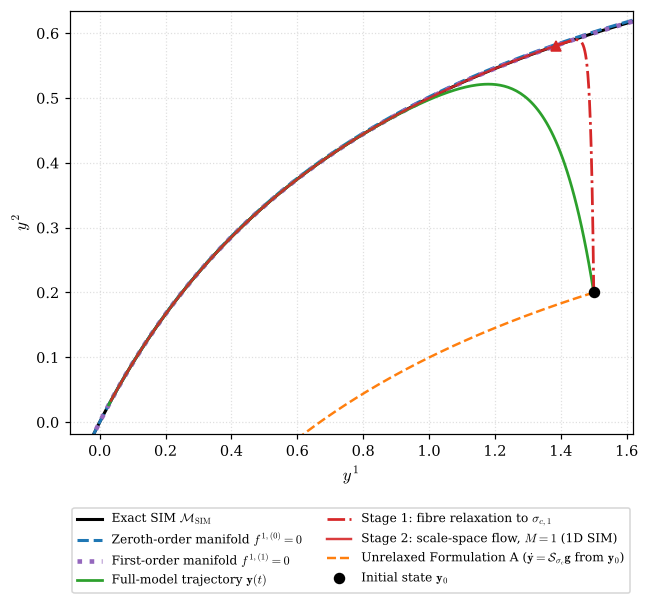 | 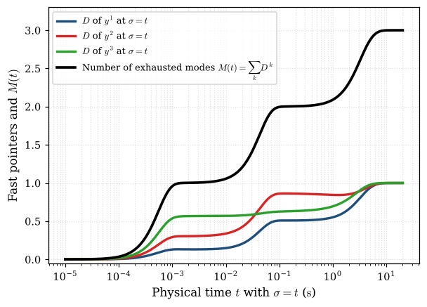 | 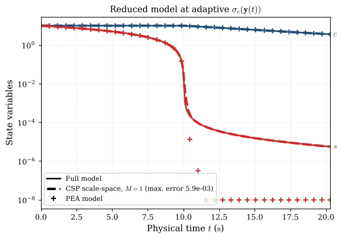 |
| Two-stage operator: fibre relaxation, then tangent flow | Sequential mode exhaustion, `σ = t` | Scale-space reduced model across a regime shift |

---

## Contents

1. [Installation](#installation)
2. [Quick start](#quick-start)
3. [Describing your model](#describing-your-model)
4. [What you get: the figure catalogue](#what-you-get-the-figure-catalogue)
5. [The method in one page](#the-method-in-one-page)
6. [Using the library directly](#using-the-library-directly)
7. [Reproducing the paper](#reproducing-the-paper)
8. [Settings reference](#settings-reference)
9. [Assumptions and limitations](#assumptions-and-limitations)
10. [Repository layout](#repository-layout) · [Tests](#tests) · [Documentation](#documentation) · [Citation](#citation)

---

## Installation

```bash
git clone https://github.com/drmitss/csp-scale-space.git
cd csp-scale-space
pip install -e .            # add ".[test]" for pytest, ".[docs]" for the documentation
```

Requires Python ≥ 3.9 with NumPy, SciPy, Matplotlib, SymPy and PyYAML (installed automatically).

## Quick start

**From the command line** - no Python needed:

```bash
csp-scalespace template my_model.yaml      # write a commented template, then edit the equations
csp-scalespace run my_model.yaml -o figs   # all figures + figs/report.md
csp-scalespace run davis_skodje            # or try a built-in model
```

**From Python:**

```python
import csp_scalespace as css

model = css.ODEModel.from_equations(
    equations={"y1": "-y1",
               "y2": "-(y2 - y1/(1 + y1))/eps - y1/(1 + y1)**2"},
    parameters={"eps": 0.08},
    initial_conditions={"y1": 1.5, "y2": 0.2},
)
study = css.ScaleSpaceStudy(model, t_end=4.0)
study.make_figures("figs")                 # PNG files + report.md
print(study.summary())                     # timescales, cutoff scales, pointers
```

The Jacobian and all other derivatives are obtained symbolically from the text of the equations -
you never write them by hand.

## Describing your model

A model is an autonomous system `dy/dt = g(y)`, `y(0) = y0`. There are three equivalent ways to
provide it.

### 1. A model file (YAML or JSON)

```yaml
name: three_scale
description: "3D three-timescale network"

parameters:  {eps1: 1.0e-3, eps2: 5.0e-2}

definitions:                         # optional intermediate quantities
  R1: "(y1*y2 - y3)/eps1"
  R2: "(y1/(1 + y1) - y2)/eps2"

equations:                           # d(variable)/dt = expression
  y1: "-0.4*R1 - R2 - 0.5*y1"
  y2: "-0.6*R1 + R2 - 0.2*y2**2"
  y3: "R1 - 0.1*y3"

initial_conditions: {y1: 1.0, y2: 0.78, y3: 0.18}

settings:                            # analysis options; only t_end is required
  t_end: 20.0
  time_scale: log
  t_start: 1.0e-5
```

Expressions use Python syntax (`**` for powers; `exp`, `log`, `sqrt`, `Max`, ... are available).
Optional blocks: `labels` (axis labels), `exact_sim` (an analytically known SIM),
`reference_models` (classical reduced models such as QSSA/PEA to overlay), `settings`.
Complete, commented examples: [`src/csp_scalespace/models/`](src/csp_scalespace/models) (the three
models of the paper and `template.yaml`).

### 2. Equations as text, in Python

`ODEModel.from_equations(equations, initial_conditions, parameters, definitions, labels, exact_sim)` -
the same content as the model file, as dictionaries (see the quick start).

### 3. Python functions

For models that cannot be written as formulas (table look-ups, external libraries):

```python
def rhs(y, p):                                   # g(y); p is the parameter dictionary
    return [-p["k"] * y[0], p["k"] * y[0] - y[1]]

model = css.ODEModel(rhs, y0=[1.0, 0.0], params={"k": 50.0})      # jac=..., jac_dot=... optional
```

Missing derivatives are approximated by finite differences. See
[`examples/02_model_from_python_functions.py`](examples/02_model_from_python_functions.py)
(Robertson kinetics).

## What you get: the figure catalogue

`study.make_figures(outdir)` / `csp-scalespace run` writes the files below. Every curve is computed
from your model; nothing is schematic. The *paper* column gives the corresponding figure of the
manuscript, where the same content is shown for the benchmark models.

**Theory group** - the construction of the method, step by step

| file | paper | content |
|---|---|---|
| `01_time_evolution` | Fig. 1a, 7a | state variables in time, fast initial layer shaded |
| `02_phase_portrait` | Fig. 1b, 7b | trajectories collapsing onto the slow invariant manifold, fast-fibre directions |
| `03_filter_weights` | Fig. 2 | survival weights `w_i(σ)` of all modes, timescales `τ_i`, cutoff scales `σ_c`, SIM windows |
| `04_isotropic_vs_anisotropic` | Fig. 3 | naive Gaussian smoothing drifts off the SIM; anisotropic CSP filtering returns perturbed states to it |
| `05_geometric_duality` | Fig. 4 | Formulation A (filter the velocity) vs. Formulation B (relax the state) at the initial state |
| `06_refinement_geometry` | Fig. 5 | basis vectors before/after the B- and A-refinements; tangency error of both bases |
| `07_two_stage` | Fig. 6a, 13 | Stage 1 fibre relaxation + Stage 2 tangent flow in phase space (2-D or 3-D) |
| `08_refinement_convergence` | Fig. 6b | error orders vs. the spectral gap (needs `gap_parameter`) |

**Applications group** - diagnostics and reduced models along the trajectory

| file | paper | content |
|---|---|---|
| `09_timescales` | Fig. 8a, 12b | `τ_i(y(t))` and adaptive cutoff scales `σ_c,M(t) = sqrt(τ_M τ_{M+1})` |
| `10_pointers_vs_scale_t*` | Fig. 9a-c, 11a | fast/slow CSP pointers of each variable against `σ` at the snapshot times |
| `11_pointers_trajectory` | Fig. 8b, 9d | pointers at the adaptive scale along the trajectory: which variable is slaved, and when |
| `12_realtime_pointers` | Fig. 12c | pointers with `σ = t`: staircase `M(t) = 0 → 1 → 2 → ...` |
| `13_fiber_relaxation` | Fig. 11b | initial state relaxed across all scales: one plateau per manifold |
| `14_model_comparison_*` | Fig. 10, 12a | scale-space reduced models (every level `M`, adaptive or fixed `σ`) vs. full and reference models |

Examples for the three built-in models are in
[`docs/_static/gallery/`](docs/_static/gallery). A few of them:

| Davis-Skodje | Michaelis-Menten | Three-scale network |
|---|---|---|
| 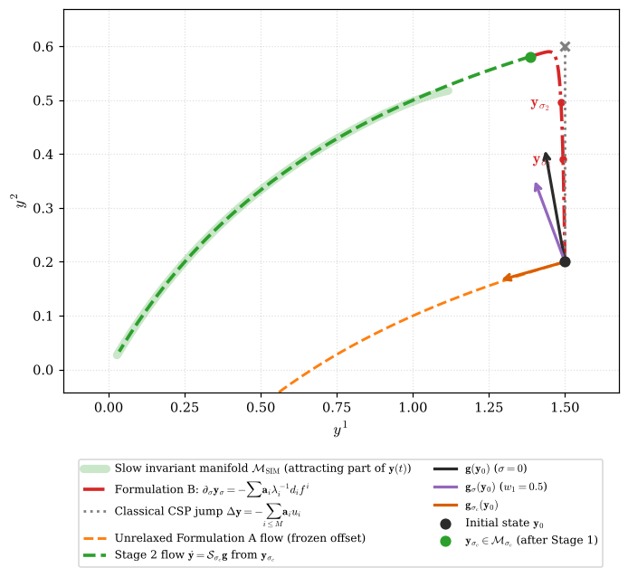 | 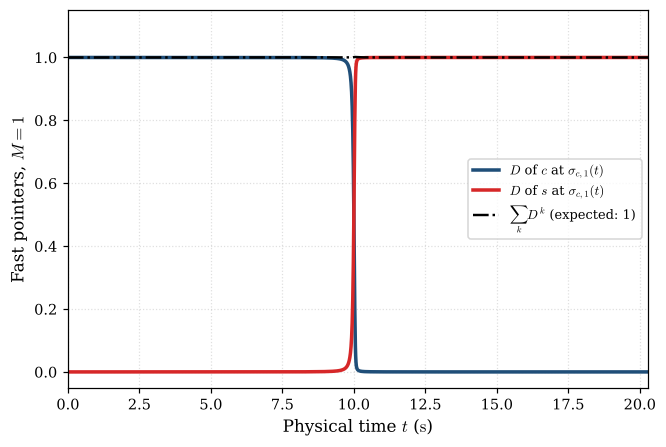 | 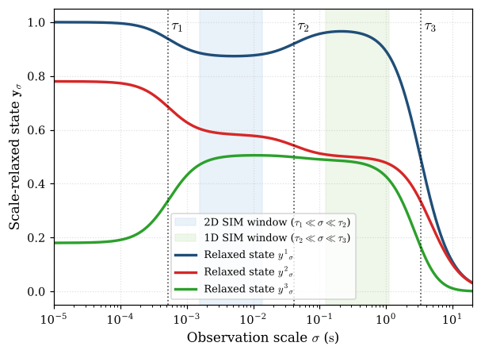 |
| 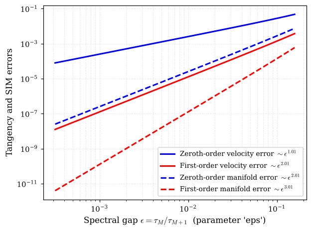 | 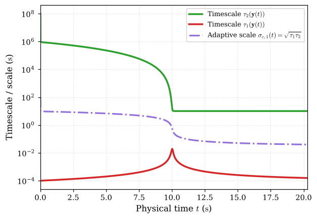 | 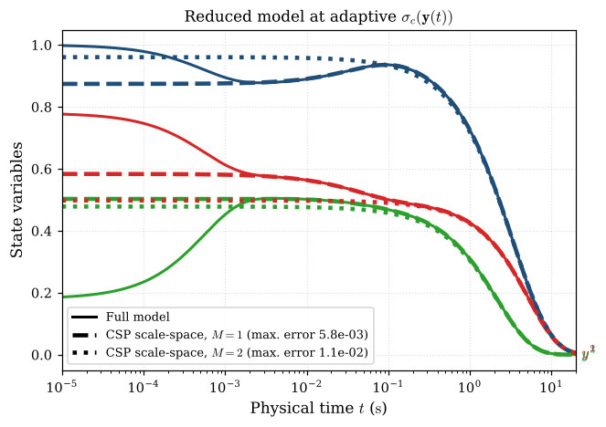 |

## The method in one page

| step | formula | paper | function |
|---|---|---|---|
| CSP basis: right/left eigenvectors of the Jacobian, fastest mode first | `J a_i = λ_i a_i`, `b^i J = λ_i b^i`, `τ_i = 1/|λ_i|` | Eqs. 19, 26 | `csp_basis(model, y)` |
| modal amplitudes | `f^i = b^i · g` | Eq. 12 | `basis.amplitudes(g)` |
| survival weight of mode `i` at scale `σ` | `w_i = exp[-(σ/τ_i)^p]` (or rational, or sharp) | Eqs. 36-37 | `ScaleFilter.weights` |
| scale-space operator | `S_σ = A W B` | Eq. 43 | `scale_space_operator` |
| **Formulation A** - filter the velocity, state fixed | `g_σ = S_σ g` | Eq. 42 | `filtered_field` |
| **Formulation B** - relax the state along fast fibres | `∂y_σ/∂σ = -Σ a_i (d_i/λ_i) f^i` | Eq. 49 | `fiber_relaxation` |
| cutoff scale in the centre of a spectral gap | `σ_c = sqrt(τ_M τ_{M+1})` | Thm 4.2 | `cutoff_scale` |
| scale-dependent pointers | `D^k = Σ_i (1-w_i) a_i^k b^i_k`, `S^k = 1 - D^k` | Eqs. 56-57 | `pointers` |
| first-order refinement (curvature) | `B_f ← B_f + P0 B_s`, `A_f ← A_f - A_s Q0`, ... | Eqs. 66-73 | `refine_basis`, `csp_basis(..., order=1, M=M)` |
| two-stage reduced model | Stage 1: `y → y_σ`; Stage 2: `ẏ = S_σ(y) g(y)` | Eq. 50 | `two_stage_rhs`, `study.reduced(M)` |

With the sharp filter `S_σ` is exactly the classical CSP slow projector with `M(σ)` exhausted modes
(Eq. 45); with a smooth filter and `σ = σ_c` it agrees with it up to `O(ε)`, `ε = τ_M/τ_{M+1}`
(Theorem 4.2), and with the first-order basis the filtered field is tangent to the SIM up to
`O(ε²)` (Theorem 5.3). Both statements are checked in the test-suite.

## Using the library directly

```python
import csp_scalespace as css
from csp_scalespace.models import three_scale

model = three_scale()
basis = css.csp_basis(model, model.y0)                 # λ_i, τ_i, A, B
s1 = css.cutoff_scale(basis.tau, 1)                    # centre of the first spectral gap
D, S = css.pointers(basis, s1)                         # fast / slow pointers of y1, y2, y3
g_s = css.filtered_field(model, model.y0, s1)          # Formulation A
path = css.fiber_relaxation(model, model.y0, "adaptive", M=1)   # Formulation B -> point on the 2D SIM
rhs = css.two_stage_rhs(model, M=1, sigma="adaptive")  # reduced model, ready for any ODE solver
y = css.integrate(rhs, path.final, [0.0, 1.0, 5.0])
```

More in [`examples/`](examples): `01_model_from_equations.py`, `02_model_from_python_functions.py`,
`03_low_level_operators.py`.

## Reproducing the paper

```bash
python paper/reproduce_paper_figures.py            # all 13 figures (28 panels) -> paper_figures/*.pdf, *.png
python paper/reproduce_paper_figures.py --only 6 12
```

The scripts in [`paper/`](paper) are the original figure code of the manuscript with the numerics
routed through this library. `PAPER_FIGURES` in `reproduce_paper_figures.py` maps each figure and
panel to its function and file name. Figures 3, 4 and 5 of the paper are *schematic illustrations*;
their computed counterparts are figures `04`-`06` of the catalogue above.

| Fig. 6a | Fig. 9b | Fig. 13 |
|---|---|---|
|  | 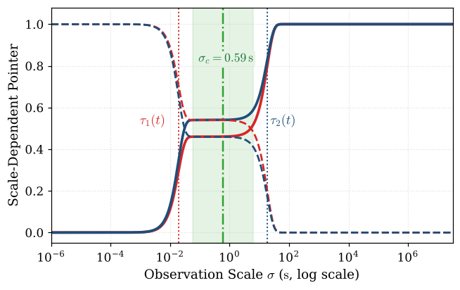 | 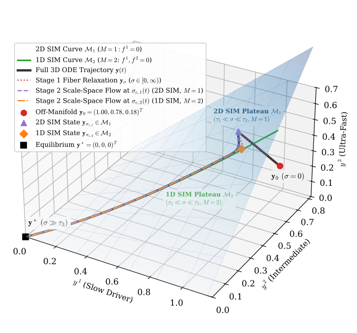 |

## Settings reference

All settings can be given in the `settings:` block of a model file or as keyword arguments of
`ScaleSpaceStudy`. Only `t_end` is required.

| setting | default | meaning |
|---|---|---|
| `t_end`, `n_points` | -, 800 | final time and number of output times |
| `time_scale`, `t_start` | `linear`, 0 | `log` for dynamics spanning decades (then `t_start > 0` is the first output time) |
| `time_unit` | `""` | unit shown on axes |
| `filter`, `p` | `gaussian`, 2 | scale filter: `gaussian`, `exponential` (exponent `p`), `rational` |
| `fiber_filter` | same as `filter` | filter used for Formulation B (`rational` is the most robust over many decades of `σ`) |
| `order` | 1 | CSP basis: 0 = Jacobian eigenvectors, 1 = one B- and one A-refinement |
| `levels` | all gaps | numbers `M` of exhausted modes to analyse |
| `fixed_sigmas` | `[]` | additional reduced models at constant `σ` |
| `stabilize`, `tau_relax_max` | `true`, none | keep the reduced model on the manifold (continuous Stage 1 term) |
| `snapshots` | `[0]` | times of the pointer-vs-scale figures |
| `sigma_range` | automatic | range of the scale axis |
| `phase_variables`, `phase_log` | first 2-3 variables, `false` | variables and axis type of phase-space figures |
| `extra_initial_conditions`, `extra_t_end` | automatic | additional trajectories of the phase portrait |
| `log_states`, `state_floor` | `false`, none | logarithmic state axes |
| `gap_parameter`, `gap_values`, `gap_reference_state` | none | parameter sweep for `08_refinement_convergence` |
| `reference_models` | `{}` | reduced models to overlay in `14_model_comparison` |
| `rtol`, `atol` | 1e-10, 1e-12 | integrator tolerances (Radau) |

## Assumptions and limitations

The implementation follows the assumptions of the paper (Section 3.3) and reports when they fail:

* **Real spectrum.** Complex-conjugate eigenvalues are outside the theory (Section 8.5); a
  `ComplexSpectrumWarning` is issued and results at such states should not be trusted.
* **Ordered, non-crossing timescales.** Modes are sorted by `|λ_i|` at every state. Where two
  eigenvalues cross, the refinement (which divides by `λ_m - λ_n`) is ill-conditioned.
* **Dissipative fast modes.** Formulation B relaxes only modes with `λ_i < 0`; conserved
  (`λ = 0`) and growing modes are left untouched.
* **Stage 2 stabilisation.** For long integrations the reduced model contains, by default, a
  continuous Stage-1 term that returns the state to the manifold on the time scale `σ`
  (`stabilize`); this is the form used for the Michaelis-Menten and three-scale results of the paper.
  Set `stabilize: false` for the pure tangent flow of Eq. (50).
* **Refined timescales.** The first-order basis keeps the eigenvalue timescales `τ_i`; the
  refined diagonal entries `Λ^{i,(1)}_i` differ from them at higher order only.
* Dense linear algebra (one eigen-decomposition per evaluation): intended for small and medium `N`.

## Repository layout

```
src/csp_scalespace/
    model.py        ODEModel: equations / model files / Python functions
    csp.py          CSP basis: eigenbasis and first-order B-, A-refinement
    filters.py      scale filters (weights, attenuation rates)
    scalespace.py   operators: S_sigma, pointers, Formulation A and B, two-stage model
    study.py        ScaleSpaceStudy: trajectory, diagnostics, reduced models, settings
    figures.py      model-independent figure catalogue
    cli.py          the csp-scalespace command
    models/         built-in models (YAML) and the model-file template
paper/              exact reproduction of the manuscript figures
examples/           three worked examples and a model-file template
tests/              unit tests, regression tests against numbers quoted in the paper
docs/               Sphinx documentation sources (Read the Docs ready) and figure gallery
```

## Tests

```bash
pip install -e ".[test]" && pytest
```

`tests/test_paper_values.py` compares the library against values printed in the manuscript
(Stage-1 state of Section 5.3, the error orders of Fig. 6b, Table 2, Eq. 104, Table 3).

## Documentation

The manual is hosted at <https://csp-scale-space.readthedocs.io> (tutorials for the three benchmark
models, a walkthrough for your own model, figure catalogue, settings, theory-to-code map, API).
Its sources are in [`docs/`](docs) (Sphinx + MyST Markdown); Read the Docs builds them on every push
using `.readthedocs.yaml`. To preview locally:

```bash
pip install -e ".[docs]" && sphinx-build -b html docs docs/_build/html
```

## Citation

If you use this software, please cite the paper (see [`CITATION.cff`](CITATION.cff)):

```bibtex
@article{ManiasNajman_CSPScaleSpace,
  author  = {Manias, Dimitris M. and Najman, Laurent},
  title   = {Anisotropic Spectral Scale-Space Formulation for Multiscale Nonlinear Ordinary
             Differential Equations via Computational Singular Perturbation},
  year    = {2026},
  note    = {Manuscript}
}
```

## License

MIT - see [`LICENSE`](LICENSE).
